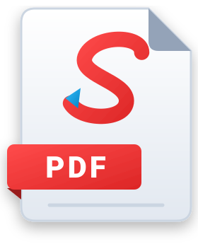

# Shahid PDF

### Your everyday PDF work, made simpler.

A fast, lightweight PDF editor for Windows, built for office documents, 
bank forms, scanned paperwork and engineering drawings.

  

**Read, comment, fill forms, sign, print and measure 3D models for free.** 
Try every Pro tool with a **7-day free trial**: no registration, no payment details.

---

## Install

Windows 10 (version 1809 or later) and Windows 11 · 64-bit · about 23 MB

1. Open the release above and download **ShahidPDF_Setup** under **Assets**.
2. Run it. If Windows shows *"Windows protected your PC"*, click **More info**, then **Run anyway**.
3. Open your first PDF. Already installed? Shahid PDF offers the update by itself.

---

## Less time fighting PDFs. More time getting work done.

- **Fill any form, even a scan.** Type into fillable fields, or add text, ticks and crosses to scanned forms. Letter boxes make names, IC numbers and dates easy, and long names flow into the next row.
- **Review with ease.** Highlight, underline, add notes and attachments, and see every comment in one list. Your comments also open in other PDF readers.
- **Compare two versions (Pro).** Smart Compare shows what changed between two contracts, documents or drawing revisions, in red and green, with a review list, saved sessions and PDF reports. It reads scanned pages too.
- **Built for engineering drawings.** Large pages stay smooth to scroll, and you can zoom in up to 6700% to read the smallest dimension. Use layers and line weights, and view embedded 3D models right on the page.
- **Measure 3D models, free.** Point at a corner, edge, circle or face to get its size, distance or angle, in mm or inches.
- **Organize pages your way (Pro).** See every open PDF on one page, drag pages between files, rotate, delete, extract or cut out part of a page, then combine everything into one PDF.
- **Print with confidence.** Live preview, paper and scale, several pages per sheet, two-sided printing (including manual), or just a marked area.
- **Your documents stay on your PC.** Editing and text recognition (OCR) run locally, and your documents are never uploaded. The internet is used only for activation, the trial, licence checks, prices and updates.

## Free or Pro? Choose what you need.

| Free: everyday PDF work | Pro: advanced tools |
| --- | --- |
| Read, search and copy text; tabs, bookmarks and layers | Edit existing text in any font; find & replace |
| Highlights, notes and comments | Smart Compare for documents and drawings |
| Fill PDF fields and scanned forms | Organize & Combine pages and files |
| Place signature images | Redact sensitive text and pictures |
| Print with a live preview | Company chops, stamps and watermarks |
| View and measure embedded 3D models | Searchable PDFs with OCR |
| Copy, save or print a marked area | Compress PDFs; add or remove password protection |

**Want to try Pro?** Open Shahid PDF's upgrade window and start your **7-day free trial**, once per computer. It ends by itself, with no charge.

## Affordable Pro plans

| Plan | Covers |
| --- | --- |
| **1-year licence** | 1 PC for one year |
| **Lifetime licence** | 1 PC, every version 1.x |
| **Business pack** | 5 PCs, every version 1.x |

- **Lifetime means every 1.x version.** Updates within 1.x are free; a future version 2 may be a separate purchase. Licences bought earlier keep the terms they were bought under.
- **No automatic charges.** Direct-sale licences do not renew by themselves. Updates do not extend a 1-year licence or the trial.
- **After the trial or a 1-year licence ends**, your PDFs stay usable with the Free features. Saved Smart Compare sessions need active Pro.
- **Licences are tied to a computer.** Current prices and launch offers are in the upgrade window, or contact us below.
- **Refunds:** for a direct purchase, contact the seller with your receipt. Your consumer rights under law are not affected.

## What's new

**1.3.5**: privacy notice in English and Bahasa Malaysia (Help > About), clearer licence terms, and an installer with support details and an optional default-PDF-app prompt.

**1.3.4**: measure 3D models (size, distance, angle) for free. 3D drawings whose main parts were missing now show completely.

**1.3.3**: a tidier toolbar with one zoom button and a zoom slider; Fill & Sign is easier to reach; remove a highlight from just the text you select.

**1.3.2**: zoom up to 6700% on large drawings; recent files on empty tabs and the taskbar; print several pages per sheet.

**1.3.1**: edit and add text in any font on your PC, previewed live; find & replace re-wraps long words; sharper text recognition.

**1.3.0**: **Smart Compare** for documents, scans and engineering drawings.

Full details are in each [release](https://github.com/mshahid98/shahidpdf-releases/releases) and in **Help > What's New** in the app.

## Questions, feedback or a Pro licence?

[Email Shahid PDF](mailto:mshahidlatif20@gmail.com) · [WhatsApp](https://wa.me/60128026693) · [Release history](https://github.com/mshahid98/shahidpdf-releases/releases)

For a bug report, include your Shahid PDF version, what you were doing, and what happened. Share a sample document only if you have permission and it contains no sensitive information.

The licence terms and privacy notice are shown during installation and in **Help > About**.

Built in Malaysia by **MOHD SHAHID BIN ABD LATIF** · SSM **202603261027 (IP0633380-D)**

**[Download Shahid PDF and try it today →](https://github.com/mshahid98/shahidpdf-releases/releases/latest)**
